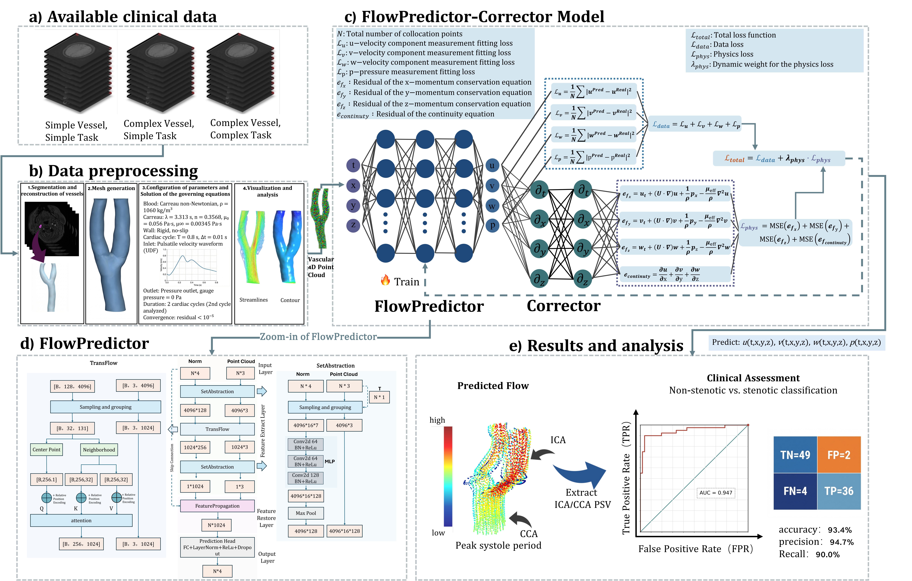

# FlowPredictor-Corrector

A hemodynamics-guided two-step deep learning framework for patient-specific vascular flow prediction.

DOI updated: [10.1109/JBHI.2026.3741575](https://doi.org/10.1109/JBHI.2026.3741575).

## Paper

- Title: `FlowPredictor-Corrector: A Hemodynamics-Guided Two-Step Deep Learning Framework for Vascular Flow Prediction`

## What This Repository Implements

FlowPredictor-Corrector (FPC) uses a two-step design:

1. `FlowPredictor`: point-cloud learning for geometry-to-flow mapping.
2. `Corrector`: physics-informed correction using Navier-Stokes residual constraints.

The method is designed for fast 4D hemodynamics prediction from vascular geometry while preserving physical plausibility.

## Method Overview

<div align="center">
  
</div>

Core modules described in the manuscript:

- `TransFlow`: local self-attention with relative positional encoding for geometry-flow coupling.
- `ChronoSample`: temporally consistent neighborhood sampling for pulsatile flow.
- `AdaPhys`: adaptive loss balancing between data loss and physics loss.
- `Corrector`: momentum + continuity residual constraints.

### Paper-to-Code Mapping

| Manuscript Concept | Code Location | Notes |
|---|---|---|
| FlowPredictor | `predictor.py` (`FlowPredictor`) | Point-cloud backbone for `t,x,y,z -> u,v,w,p` |
| Corrector (PINN residual) | `corrector.py` (`PhysicsCorrector`) | Navier-Stokes momentum + continuity residual |
| Unified FPC model | `fpc_model.py` (`FPCModel`) | Combines predictor and adaptive data/physics loss |
| Training loop (legacy script) | `train.py` | Script-style training/in-loop logging |
| Training loop (modular framework) | `run.py` + `core/trainer.py` | Config-driven, hook-based pipeline |
| Inference loop | `test.py` / `core/inference.py` | Sample-wise prediction and metric export |

## Repository Structure

```text
FlowPredictor-Corrector/
├── configs/
│   └── default.yaml
├── core/
├── utils/
├── predictor.py
├── corrector.py
├── fpc_model.py
├── train.py
├── test.py
├── run.py
├── examples/
│   ├── README.md
│   ├── train_example.sh
│   ├── test_example.sh
│   └── preprocess_example.sh
└── paper_assets/
    └── fig1.jpg
```

## Installation

```bash
conda create -n fpc python=3.9 -y
conda activate fpc
pip install -r requirements.txt
```

## Quick Start

### Recommended Entry Point

Use the unified interface unless you need legacy script compatibility:

```bash
python run.py --config configs/default.yaml --mode train
python run.py --config configs/default.yaml --mode test --checkpoint outputs/weights/best_model.pth
```

### Legacy Script Entry Points

```bash
bash examples/train_example.sh
bash examples/test_example.sh
```

### Notes for Sample Inference Data

- Sample assets shipped in this repository:
  - input directory: `./test_data`
  - weight file: `./test_weight/best.pth`
- The current test script expects additional metadata (`./test_data/test_data.pkl`) referenced in `examples/test_example.sh`.
- If this file is absent in your local copy, generate/prepare the matching metadata first before running `test.py` or `run.py --mode test`.

### Preprocessing

Before preprocessing, verify that `generate_data_pkl.py` input/output paths match your environment.

## Data Format

Raw sample format per row:

```text
t x y z u v w p
```

- `t, x, y, z`: temporal-spatial coordinates
- `u, v, w, p`: velocity components and pressure

The dataset loader expects text files with a header line and numeric rows.

## Reproducibility Notes

- The repository provides training/testing code and a representative sample case (`test_data`, `test_weight`).
- For preprocessing, check and adjust paths in both `examples/preprocess_example.sh` and `generate_data_pkl.py` before use.

### Current Implementation Notes (as of 2026-03-05)

- The repository currently contains both a modular pipeline (`run.py`, `core/`) and legacy scripts (`train.py`, `test.py`).
- Some example commands and helper scripts require local path/interface alignment before first use.
- For paper reproduction, we recommend fixing paths and validating one end-to-end run on a small subset before launching full training.

## Citation

If you use this repository, please cite:

```bibtex
@ARTICLE{11726865,
  author={Li, Zhuo and Zeng, Yao and Wang, Mengfei and Yang, Yulu and Pan, Meixiu and Liu, Ao and Sun, Qiang and Zhao, Haifeng and Zhang, Ruipeng and Li, Yuehua},
  journal={IEEE Journal of Biomedical and Health Informatics},
  title={FlowPredictor–Corrector: A Hemodynamics-Guided Two-Step Deep Learning Framework for Vascular Flow Prediction},
  year={2026},
  pages={1-11},
  doi={10.1109/JBHI.2026.3741575}
}
```

## License

MIT License. See [LICENSE](LICENSE).
